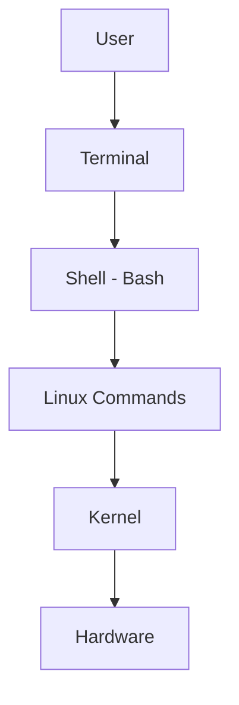

# 01. Terminal Basics

## 1. What is a Linux Terminal?

A Linux terminal is a text-based interface used to communicate with the operating system through commands.

## 2. What is CLI?

CLI stands for Command Line Interface.

It allows users to interact with Linux by typing commands.

## 3. What is a Shell?

A shell is a command interpreter that accepts user commands and executes them.

**Popular Linux shells:**

- Bash
- Sh
- Zsh
- Ksh
- Fish

## 4. Terminal vs Shell

| Terminal | Shell |
|---|---|
| Provides an interface | Interprets commands |
| Displays output | Executes commands |
| Example: GNOME Terminal | Example: Bash |

## 5. How They Work Together



## 6. Linux Command Prompt

Example:

```bash
[root@server ~]#
```

| Component | Meaning |
|---|---|
| root | Username |
| server | Hostname |
| ~ | Current home directory |
| # | Root user prompt |

A normal user prompt usually ends with `$`.

## 7. Basic Terminal Commands

| Command | Purpose |
|---|---|
| `whoami` | Display current user |
| `hostname` | Display hostname |
| `pwd` | Show current directory |
| `date` | Display date and time |
| `clear` | Clear terminal |
| `history` | Show previous commands |
| `tty` | Show terminal device |
| `uptime` | Show system uptime |
| `id` | Display user and group IDs |
| `echo $SHELL` | Display current shell |

## 8. Linux Command Syntax

General syntax:

```bash
command [options] [arguments]
```

Example:

```bash
ls -l /etc
```

- `ls` – Command
- `-l` – Option
- `/etc` – Argument

## 9. Useful Keyboard Shortcuts

| Shortcut | Purpose |
|---|---|
| Ctrl + C | Stop foreground command |
| Ctrl + L | Clear screen |
| Ctrl + D | Send EOF |
| Ctrl + A | Move to beginning of line |
| Ctrl + E | Move to end of line |
| Tab | Auto-completion |
| Ctrl + R | Search command history |

## 10. Environment Variables

Environment variables store information used by the shell and processes.

| Variable | Purpose |
|---|---|
| `$HOME` | User's home directory |
| `$USER` | Current username |
| `$SHELL` | Default shell |
| `$PATH` | Executable search directories |
| `$PWD` | Current working directory |

Example:

```bash
echo $HOME
echo $PATH
echo $USER
```

## 11. Common Errors

**Command not found**

Occurs when a command is unavailable or incorrectly typed.

**Permission denied**

Occurs when the user does not have sufficient permissions.

**No such file or directory**

Occurs when the specified file or directory does not exist.

## 12. Interview Questions

**Q1. What is a terminal?**

A text-based interface used to execute Linux commands.

**Q2. What is a shell?**

A command interpreter that executes user commands.

**Q3. What is Bash?**

Bash stands for Bourne Again Shell.

**Q4. Difference between terminal and shell?**

Terminal provides the interface; shell interprets commands.

**Q5. How do you check the current user?**

`whoami`

**Q6. How do you check the kernel version?**

`uname -r`

**Q7. What is PATH?**

An environment variable containing directories searched for executable commands.

---

## References

- Red Hat Documentation
- GNU Bash Manual
- Linux Man Pages

**Status:** Documentation completed.
