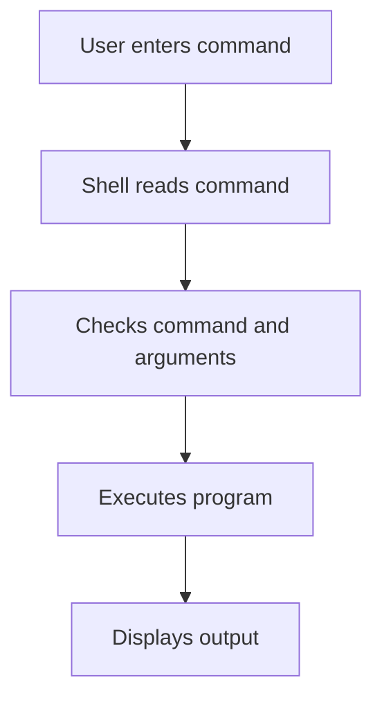

# 02. Linux Command Syntax

## 1. What is a Linux Command?

A Linux command is an instruction given to the operating system to perform a specific task.

Examples:
- `ls` – List files
- `pwd` – Show current directory
- `mkdir` – Create directory
- `cp` – Copy files

## 2. Basic Command Structure

```bash
command [options] [arguments]
```

**Example:**

```bash
ls -l /etc
```

- `ls` – Command
- `-l` – Option
- `/etc` – Argument

## 3. Commands, Options and Arguments

| Term | Meaning | Example |
|---|---|---|
| Command | Performs an operation | `ls` |
| Option | Modifies command behaviour | `-l` |
| Argument | Specifies the target | `/etc` |

## 4. Types of Options

### Short Options

Usually use a single hyphen.

```bash
ls -l
```

### Long Options

Usually use two hyphens.

```bash
ls --all
```

### Combined Options

Multiple short options can be combined.

```bash
ls -la
```

- `-l` – Long listing
- `-a` – Show hidden files

## 5. Linux Command Examples

| Command | Purpose |
|---|---|
| `ls -l` | Detailed file listing |
| `ls -a` | Show hidden files |
| `mkdir test` | Create directory |
| `touch file.txt` | Create empty file |
| `rm file.txt` | Remove file |
| `cp file1 file2` | Copy file |
| `mv file1 file2` | Move or rename file |

## 6. Command Execution Flow



## 7. Important Points

- Linux commands are generally case-sensitive.
- Commands and arguments must be separated by spaces.
- Options modify command behaviour.
- Arguments specify files, directories or other targets.
- Use `man command` to read command documentation.

## 8. Interview Questions

**Q1. What is Linux command syntax?**

The general structure is `command [options] [arguments]`.

**Q2. What is an option?**

An option modifies how a command works.

**Q3. What is an argument?**

An argument specifies the target on which a command operates.

**Q4. What is the difference between `-a` and `--all`?**

Both are options for displaying hidden files with `ls`. `-a` is the short form and `--all` is the long form.

**Q5. Are Linux commands case-sensitive?**

Yes. Linux commands and filenames are generally case-sensitive.

## References

- Linux Manual Pages
- GNU Coreutils Documentation

**Status:** Documentation completed.
