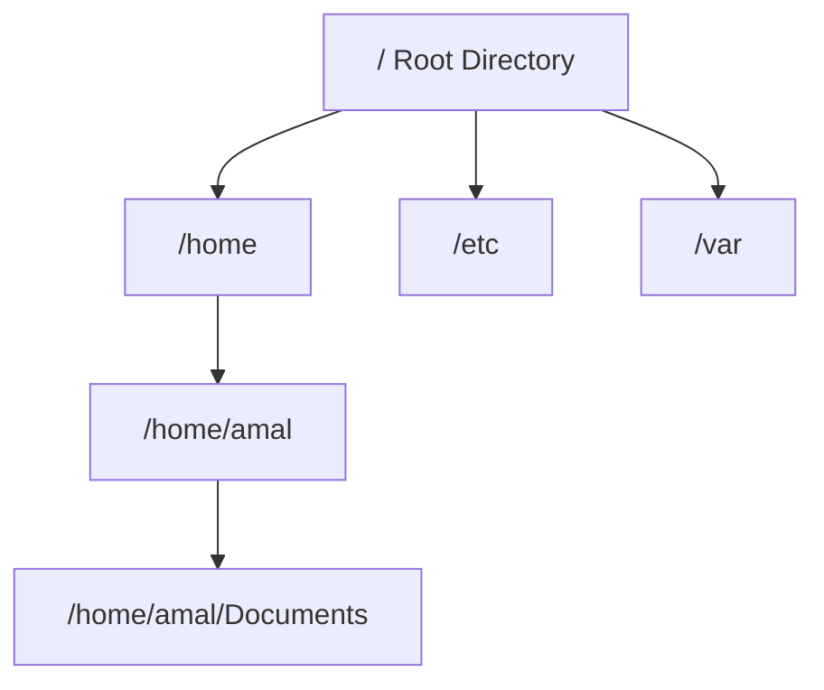

# 03. Linux Navigation Commands

## 1. Introduction

Linux navigation commands help users move between directories and explore the filesystem.

The three important commands are `pwd`, `ls` and `cd`.

## 2. pwd – Present Working Directory

Displays the current directory.

```bash
pwd
```

Example output:

```text
/home/amal
```

## 3. ls – List Directory Contents

Displays files and directories.

| Command | Purpose |
|---|---|
| `ls` | List files |
| `ls -l` | Detailed listing |
| `ls -a` | Show hidden files |
| `ls -lh` | Human-readable file sizes |
| `ls -lt` | Sort by modification time, newest first |
| `ls -R` | List contents recursively |

## 4. cd – Change Directory

Used to move between directories.

| Command | Purpose |
|---|---|
| `cd /etc` | Move to /etc |
| `cd ..` | Move one directory up |
| `cd ~` | Move to home directory |
| `cd /` | Move to root directory |
| `cd -` | Return to previous directory |
| `cd` | Move to home directory |

## 5. Linux Directory Navigation



## 6. Absolute Path vs Relative Path

| Absolute Path | Relative Path |
|---|---|
| Starts from `/` | Starts from current directory |
| Complete path | Path based on current location |
| Example: `/home/amal` | Example: `Documents` |

## 7. Hidden Files

In Linux, filenames beginning with a dot (`.`) are hidden by default.

Example:

```bash
ls -a
```

Common examples:

- `.bashrc`
- `.bash_profile`
- `.ssh`

## 8. Practical Examples

```bash
pwd
ls
ls -l
ls -a
cd /etc
pwd
cd ..
pwd
cd ~
```

## 9. Interview Questions

**Q1. What is pwd?**

Displays the current working directory.

**Q2. What is the use of ls?**

Lists files and directories.

**Q3. What does cd .. do?**

Moves one directory level up.

**Q4. What is the difference between absolute and relative paths?**

An absolute path starts from the root directory, whereas a relative path starts from the current directory.

**Q5. How do you display hidden files?**

Use `ls -a`.

**Q6. What does cd - do?**

Returns to the previous working directory.

**Q7. What does ls -lt do?**

Displays files in long format, sorted by modification time with newest first.

## References

- Linux Manual Pages (`man pwd`, `man ls`, `man cd`)
- GNU Coreutils Documentation

**Status:** Documentation completed.
