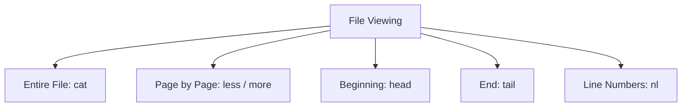

# 05. Linux File Viewing Commands

## 1. Introduction

Linux provides commands to view, read and monitor file contents.

## 2. Important Commands

| Command | Purpose |
|---|---|
| `cat` | Display file contents |
| `less` | View files page by page |
| `more` | View files one page at a time |
| `head` | Display first lines |
| `tail` | Display last lines |
| `nl` | Display file with line numbers |

## 3. Command Examples

### cat – Display File Contents

```bash
cat file.txt
```

Display multiple files:

```bash
cat file1.txt file2.txt
```

### less – View Large Files

```bash
less file.txt
```

- Space: Next page
- b: Previous page
- q: Quit

### more – View File Page by Page

```bash
more file.txt
```

### head – Display First 10 Lines

```bash
head file.txt
```

Display first 5 lines:

```bash
head -n 5 file.txt
```

### tail – Display Last 10 Lines

```bash
tail file.txt
```

Display last 5 lines:

```bash
tail -n 5 file.txt
```

Monitor a log file continuously:

```bash
tail -f /var/log/messages
```

Press `Ctrl + C` to stop monitoring.

### nl – Display Line Numbers

```bash
nl file.txt
```

## 4. Comparison

| Command | Function |
|---|---|
| `cat` | Displays entire file |
| `less` | Scrolls forward and backward |
| `more` | Displays page by page |
| `head` | Shows beginning of file |
| `tail` | Shows end of file |
| `nl` | Shows line numbers |

## 5. Graphical Representation



## 6. Practical Examples

View system logs:

```bash
cat /var/log/messages
```

View the first 10 lines:

```bash
head /etc/passwd
```

View the last 10 lines:

```bash
tail /etc/passwd
```

Monitor system logs:

```bash
tail -f /var/log/messages
```

**Note:** `/var/log/messages` is commonly available on RHEL-based systems. Log locations can vary between distributions.

## 7. Interview Questions

**Q1. What is the use of cat?**

Displays file contents.

**Q2. What is the difference between head and tail?**

`head` displays the beginning of a file, whereas `tail` displays the end.

**Q3. What is the use of tail -f?**

Continuously monitors new entries added to a file.

**Q4. What is the difference between less and more?**

Both display files page by page. `less` supports backward and forward navigation.

**Q5. How do you display the first 5 lines?**

`head -n 5 filename`

**Q6. How do you display the last 5 lines?**

`tail -n 5 filename`

## References

- Linux Manual Pages
- GNU Coreutils Documentation

**Status:** Documentation completed.
