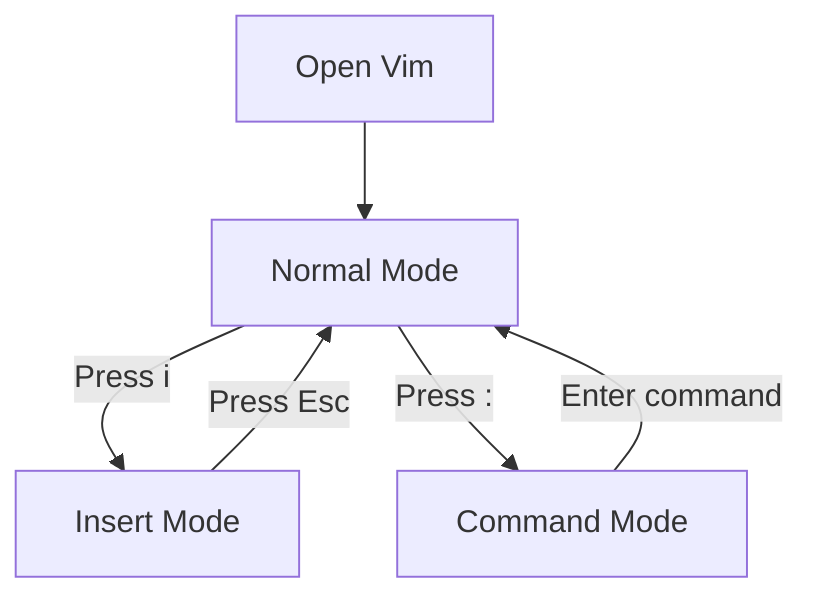

# 06. Vim and Nano Text Editors

## 1. Introduction

Vim and Nano are text editors used to create and edit files in Linux.

They are commonly used by Linux administrators to edit configuration files and scripts.

## 2. Vim Editor

Vim stands for Vi Improved.

It is a command-line text editor.

### Open or Create a File

```bash
vim file.txt
```

### Vim Modes

Vim has three main modes:

| Mode | Purpose |
|---|---|
| Normal Mode | Navigate and execute commands |
| Insert Mode | Insert or edit text |
| Command Mode | Save, quit and execute editor commands |

### Vim Mode Flow



### Important Vim Commands

| Command | Purpose |
|---|---|
| `i` | Enter Insert Mode |
| `Esc` | Return to Normal Mode |
| `:w` | Save file |
| `:q` | Quit |
| `:wq` | Save and quit |
| `:q!` | Quit without saving |
| `dd` | Delete a line |
| `yy` | Copy a line |
| `p` | Paste |
| `/word` | Search for a word |

### Example

```bash
vim file.txt
```

1. Press `i` to insert text.
2. Type your content.
3. Press `Esc`.
4. Type `:wq`.
5. Press Enter.

Your file is saved.

## 3. Nano Editor

Nano is a simple, beginner-friendly command-line text editor.

### Open or Create a File

```bash
nano file.txt
```

### Important Nano Shortcuts

| Shortcut | Purpose |
|---|---|
| Ctrl + O | Save file |
| Ctrl + X | Exit |
| Ctrl + W | Search |
| Ctrl + K | Cut line |
| Ctrl + U | Paste |
| Ctrl + G | Help |

### Example

```bash
nano file.txt
```

1. Type your content.
2. Press `Ctrl + O` to save.
3. Press Enter to confirm the filename.
4. Press `Ctrl + X` to exit.

## 4. Vim vs Nano

| Feature | Vim | Nano |
|---|---|---|
| Interface | Modal editor | Simple editor |
| Learning | Requires practice | Easy to learn |
| Modes | Multiple modes | No modal editing |
| Usage | Advanced editing | Basic editing |
| Navigation | Keyboard commands | Simple shortcuts |

## 5. Interview Questions

**Q1. What is Vim?**

Vim is a command-line text editor used to create and edit files.

**Q2. What is Nano?**

Nano is a simple command-line text editor.

**Q3. How do you save a file in Vim?**

Use `:w`.

**Q4. How do you exit Vim without saving?**

Use `:q!`.

**Q5. How do you enter Insert Mode in Vim?**

Press `i`.

**Q6. How do you save a file in Nano?**

Press `Ctrl + O`.

**Q7. What is the difference between Vim and Nano?**

Vim is a modal editor with advanced editing features, whereas Nano provides a simpler editing interface.

## References

- Vim Documentation
- GNU Nano Manual

**Status:** Documentation completed.
