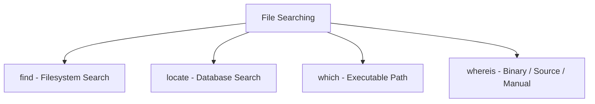

# 07. Linux File Searching Commands

## 1. Introduction

Linux provides commands to search for files, directories and executable programs.

## 2. Important Commands

| Command | Purpose |
|---|---|
| `find` | Search files and directories |
| `locate` | Quickly search files by name |
| `which` | Find executable command path |
| `whereis` | Find binary, source and manual locations |

## 3. find Command

Searches for files and directories in a specified location.

**Syntax:**

```bash
find [path] [options] [expression]
```

Examples:

Search by filename:

```bash
find /home -name file.txt
```

Search for directories:

```bash
find /home -type d
```

Search for files:

```bash
find /home -type f
```

Search for `.log` files:

```bash
find /var/log -name "*.log"
```

## 4. locate Command

Quickly searches for files using a database.

```bash
locate file.txt
```

Update the locate database:

```bash
updatedb
```

**Note:** `locate` may not be installed by default. On RHEL, install the `plocate` package if needed.

## 5. which Command

Displays the path of an executable command.

```bash
which python
```

Example output:

```text
/usr/bin/python
```

## 6. whereis Command

Displays the locations of a command's binary, source and manual files.

```bash
whereis ls
```

## 7. Comparison

| Command | Search Method |
|---|---|
| `find` | Searches the filesystem directly |
| `locate` | Searches an indexed database |
| `which` | Searches executable paths |
| `whereis` | Searches standard binary, source and manual locations |

## 8. Graphical Representation



## 9. Interview Questions

**Q1. What is the use of find?**

Searches for files and directories in the filesystem.

**Q2. What is the difference between find and locate?**

`find` searches the filesystem directly, while `locate` searches an indexed database.

**Q3. What is the use of which?**

Displays the path of an executable command found through PATH.

**Q4. What is the use of whereis?**

Finds binary, source and manual locations of a command.

**Q5. Which command searches only for directories?**

```bash
find /home -type d
```

## References

- Linux Manual Pages
- GNU Findutils Documentation

**Status:** Documentation completed.
